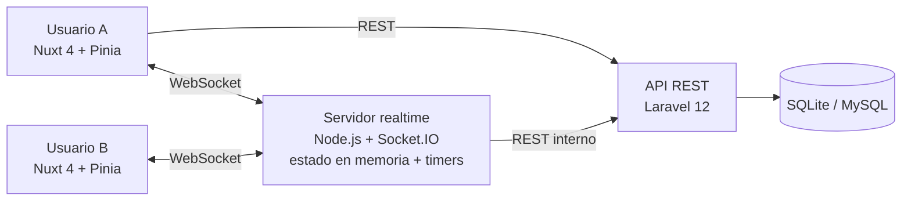
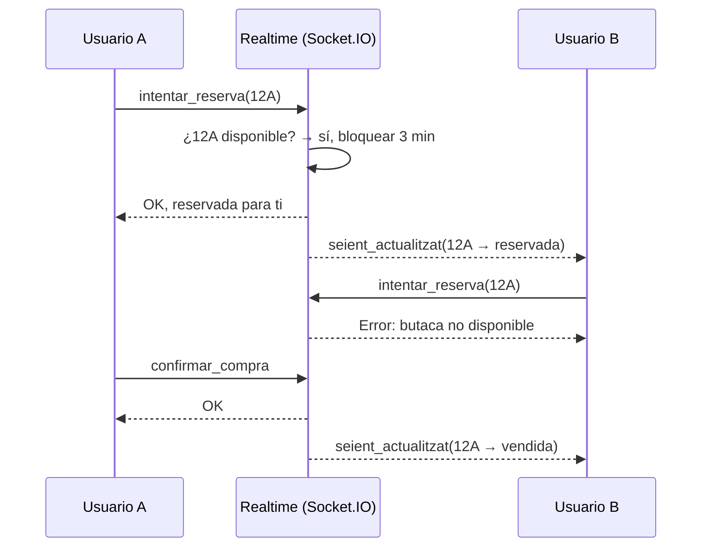

<div align="center">

# 🎭 Teatre Regalia

### Venta de entradas con reserva de butacas en tiempo real

<p>
  
  
  
  
  
  
</p>

**Trabajo de investigación (TR) individual · 2.º CFGS DAW · Institut Pedralbes · 2025-2026**<br>
👤 [Bryan Ruzafa Gonçalves](https://bryanrg.dev) · [LinkedIn](https://www.linkedin.com/in/bryan-ruzafa/)

</div>

---

## 🎯 El problema

En una venta de entradas de alta demanda, dos personas pueden ver la misma butaca libre y pulsar "comprar" a la vez. Si el sistema solo comprueba la disponibilidad al final, uno de los dos acaba con una entrada que no existe.

**Teatre Regalia** lo resuelve con un servidor de tiempo real dedicado: en cuanto un usuario selecciona una butaca, queda **bloqueada durante 3 minutos** y todos los demás la ven **reservada al instante**. Si no completa la compra, se libera sola.

## ✨ Funcionalidades

- 🎟️ **Listado y detalle de eventos** servidos por la API de Laravel.
- 🗺️ **Mapa de butacas reactivo** sincronizado entre todos los usuarios conectados mediante WebSockets.
- ⏱️ **Bloqueo temporal de 3 minutos** por butaca, con liberación automática si la compra no se completa.
- 🛒 **Proceso de compra** con datos personales y confirmación, persistido en la API de Laravel.
- 🔎 **Consulta de entradas** compradas por email.
- 📊 **Panel de administración** con CRUD de eventos, estadísticas y monitor en tiempo real de usuarios conectados y reservas activas.

## 🏗️ Arquitectura

Tres servicios desacoplados: **Laravel** guarda los datos de forma persistente y aplica la lógica de negocio, **Node.js + Socket.IO** mantiene en memoria el estado vivo de cada sala, y **Nuxt** pinta la interfaz.



### Flujo de una reserva concurrente



### Eventos de Socket.IO

| Evento | Dirección | Qué hace |
| :-- | :-- | :-- |
| `unir_esdeveniment` | cliente → servidor | Entra en la sala de un evento y sincroniza el estado de sus butacas |
| `intentar_reserva` | cliente → servidor | Intenta bloquear una butaca durante 3 minutos |
| `confirmar_compra` | cliente → servidor | Marca como vendidas las butacas reservadas por ese cliente |
| `seient_actualitzat` | servidor → sala | Notifica a todos el nuevo estado de una butaca |
| `actualitzacio_admin` | servidor → admin | Usuarios conectados y reservas activas en tiempo real |

### API REST (Laravel)

| Método | Endpoint | Descripción |
| :-- | :-- | :-- |
| `GET` | `/api/salut` | Health check de la API y de la base de datos |
| `GET` | `/api/esdeveniments` · `/api/esdeveniments/{id}` | Listado y detalle de eventos |
| `POST` | `/api/venda/confirmar` | Confirma una compra |
| `GET` | `/api/venda/consulta/{email}` | Entradas compradas por un email |
| `POST` | `/api/seients/reservar` · `/api/seients/alliberar` | Sincronización interna realtime → Laravel |
| `GET/POST/PUT/DELETE` | `/api/admin/...` | Estadísticas y CRUD de eventos |

## 🚀 Ejecutar en local

Requisitos: **PHP 8.2+**, **Composer**, **Node.js 18+**.

```bash
git clone https://github.com/BryanRuzafa/GESTOR-DE-ENTRADES.git
cd GESTOR-DE-ENTRADES

# 1. Backend (Laravel) — http://localhost:8000
cd backend
composer install
cp .env.example .env
php artisan key:generate
touch database/database.sqlite
php artisan migrate:fresh --seed
php artisan serve

# 2. Servidor realtime (Socket.IO) — puerto 3001  [otra terminal]
cd realtime && npm install && node index.js

# 3. Frontend (Nuxt) — http://localhost:3000  [otra terminal]
cd frontend && npm install && npm run dev
```

El panel de administración está en `/admin`. Guía detallada (en catalán): [`doc/instalacio.md`](doc/instalacio.md).

**Tests del backend** (PHPUnit, SQLite en memoria): reservar una butaca libre, rechazo con `409` si ya está reservada o vendida, liberación de la reserva y compra solo por el cliente que la tiene reservada:

```bash
cd backend && php artisan test
```

**Tests del frontend** (Vitest, lógica del store de butacas en Pinia):

```bash
cd frontend && npx vitest run
```

## 🔐 Limitaciones conocidas y siguientes pasos

El TR se centraba en la concurrencia en tiempo real. Antes de llevarlo a producción real, estos son los puntos que reforzaría:

| Limitación actual | Mejora prevista |
| :-- | :-- |
| Las rutas `/api/admin/*` no requieren autenticación | Autenticación con **Laravel Sanctum** y rol de administrador |
| `/api/venda/consulta/{email}` devuelve entradas sabiendo solo el email | Enlace firmado o código enviado por correo |
| La identidad del cliente en el socket la envía el propio cliente | Sesión firmada (JWT) validada en el *handshake* de Socket.IO |
| CORS abierto (`*`) en el servidor realtime | Lista blanca con el dominio del frontend |
| El estado de las reservas vive en la memoria de un único proceso | **Redis** + `@socket.io/redis-adapter` para escalar a varias instancias sin perder reservas en un reinicio |
| `/api/venda/confirmar` no comprueba en la BD si la reserva ha caducado (depende del temporizador del servidor realtime) | Filtrar por `temps_bloqueig_finalitza > now()` y añadir un test que lo cubra |
| Sin límite de peticiones | *Rate limiting* en la API y en los eventos del socket |

## 📁 Estructura

```
├── backend/    API REST en Laravel (controladores, modelos, migraciones y seeders)
├── realtime/   Servidor Node.js + Socket.IO (estado de las salas y timers de reserva)
├── frontend/   Aplicación Nuxt 4 + Pinia (páginas, mapa de butacas, panel de administración)
├── doc/        Resumen, diagramas (E/R y secuencia) y guía de instalación
└── specs/      Especificaciones del desarrollo (OpenSpec)
```

---

<div align="center">
<sub>Proyecto desplegado durante el curso en teatretr.daw.inspedralbes.cat (actualmente fuera de línea).</sub>
</div>
